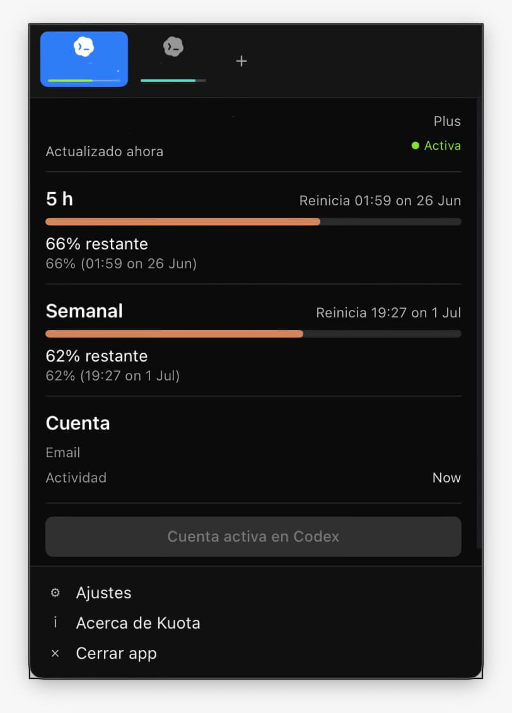
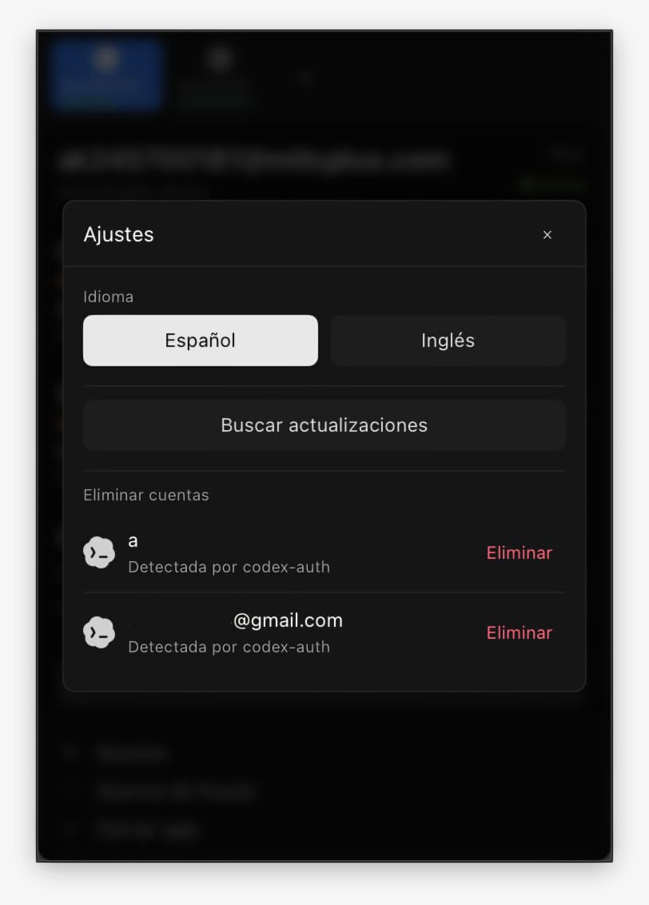

<p align="center">
  
</p>

<h1 align="center">Kuota</h1>

<p align="center">
  App de menu bar para cambiar cuentas de Codex y ver la cuota restante sin usar terminal.
</p>

---

## Que es Kuota

Kuota es una app de escritorio construida con Tauri, React y TypeScript. Su objetivo es convertir el flujo de `codex-auth` en una interfaz visual simple para usuarios que no quieren manejar cuentas desde la terminal.

La app vive en la barra del sistema:

- En macOS se despliega desde la menu bar.
- En Windows se despliega desde la bandeja inferior.
- Muestra una card por cuenta.
- Refresca la cuota consultando `codex-auth` cada 60 segundos como respaldo y reacciona de inmediato a cambios locales de cuenta.
- Permite cambiar la cuenta activa de Codex.
- Muestra la cuota semanal y la cuota de 5 horas cuando `codex-auth` entrega un porcentaje valido.
- Puede cambiar automaticamente a otra cuenta, pero solo cuando sus porcentajes de cuota son validos y mayores que `0%`.

## Base tecnica

Kuota esta basada en [loongphy/codex-auth](https://github.com/loongphy/codex-auth).

La app no usa proxy para funcionar. En su lugar, usa `codex-auth` como motor para:

- detectar cuentas disponibles;
- iniciar login guiado;
- leer el estado de cuentas;
- cambiar la cuenta activa;
- consultar el uso reportado por `codex-auth`;
- buscar e instalar actualizaciones del motor.

## Funcionamiento

### 1. Preparacion de codex-auth

Al abrir Kuota, la app revisa si `codex-auth` esta instalado.

Si no existe, Kuota puede instalarlo ejecutando:

```bash
npm install -g @loongphy/codex-auth@latest
```

Kuota necesita que Node.js y npm esten disponibles en el sistema para instalar o actualizar `codex-auth` automaticamente. Si npm no existe, la app mostrara un error y el usuario tendra que instalar Node.js primero.

Desde `Ajustes` tambien se puede buscar actualizaciones. Si hay una version nueva de `codex-auth`, Kuota intenta actualizarlo automaticamente.

### 2. Agregar cuentas

Para agregar una cuenta, Kuota abre el flujo guiado de `codex-auth login --device-auth`.

En macOS y Windows, el login se muestra dentro de Kuota: la app ejecuta `codex-auth` en segundo plano, detecta el codigo de dispositivo, lo copia automaticamente al portapapeles y abre la pagina de autorizacion de OpenAI en el navegador predeterminado. Si la copia automatica falla, el codigo queda visible para copiarlo manualmente.

En macOS el codigo se copia automaticamente con `pbcopy`; en Windows se usa el portapapeles del sistema mediante PowerShell oculto. En ambos sistemas el usuario no tiene que abrir CMD, PowerShell ni Terminal para agregar una cuenta.

Al terminar la autorizacion, Kuota vuelve a consultar la lista de cuentas automaticamente.

### 3. Ver cuotas

Kuota muestra la cuota restante, no la cuota consumida, para evitar confusiones.

La vista principal muestra:

- uso restante `Semanal`;
- uso restante de `5 horas` cuando la cuenta reporta esa ventana correctamente;
- plan detectado;
- ultima actividad;
- cuenta activa en Codex.

Kuota obtiene esta informacion ejecutando `codex-auth list` sin `--skip-api`, por lo que usa la consulta API que `codex-auth` trae activa por defecto. OpenAI no expone aqui un stream de porcentajes: la app toma un snapshot al abrir, cada 60 segundos y cuando la ventana vuelve a tomar foco. Ese intervalo queda como reconciliacion y no retrasa el auto-switch.

La ventana de 5 horas se identifica por un porcentaje valido, no por el nombre del plan. Una cuenta Free puede mostrarla cuando su sesion la reporta; respuestas como `401`, `RequestFailed` o `N/A` se tratan como errores, no como cuotas. El parser tolera tanto salidas de `codex-auth` con la columna `5H USAGE` como salidas que no la incluyan.

### 4. Cambiar cuenta activa

Cuando seleccionas una cuenta y presionas `Usar en Codex`, Kuota ejecuta:

```bash
codex-auth switch <cuenta>
```

Despues intenta reiniciar o abrir Codex para que la app tome la cuenta seleccionada:

- Si Codex Desktop estaba abierto, lo cierra y lo vuelve a abrir.
- Si detecta uso de Codex CLI, abre una nueva terminal con `codex`.
- Si no detecta nada, intenta abrir Codex Desktop.

### 5. Ajustes

Desde `Ajustes` puedes:

- cambiar idioma entre Espanol e Ingles;
- activar o desactivar el cambio automatico estricto de Kuota;
- buscar actualizaciones de `codex-auth`;
- eliminar u ocultar cuentas que ya no quieres ver en Kuota.

El cambio automatico se ejecuta solo cuando la cuenta activa llega a `0%` en una cuota aplicable y existe una candidata cuya cuota semanal es conocida y mayor que `0%`. Si la candidata reporta una ventana de 5 horas, esa cifra tambien debe ser valida y mayor que `0%`; `401`, `N/A`, `RequestFailed` y porcentajes ausentes la descartan. Si ninguna cuenta cumple estas condiciones, Kuota conserva la cuenta actual y no reinicia Codex.

Kuota deshabilita el selector automatico interno de `codex-auth` para evitar que una cuenta sin datos sea tratada provisionalmente como disponible. En su lugar, Tauri observa localmente los eventos `rate_limits` de las sesiones Codex y solicita una validacion completa solo al detectar agotamiento. El snapshot cada 60 segundos se conserva como respaldo, sin consultar la API cada segundo. Kuota no cierra sesiones de CLI en ejecucion; la cuenta nueva se aplica en la siguiente sesion del CLI.

La opcion `Cerrar app` esta disponible directamente en el footer del popup.

## Interfaz

Kuota usa una interfaz compacta y oscura inspirada en herramientas de menu bar.

El popover mide 360x590 px para mostrar juntas las cuotas de 5 horas y semanal sin scroll interno en el caso normal. La actividad y los reinicios entregados por `codex-auth` se localizan al idioma activo de Kuota: por ejemplo, `Now` se muestra como `Ahora`, `2h ago` como `hace 2 h` y `00:26 on 1 Sep` como `00:26 el 1 sep` en español.

La ventana adapta sus esquinas segun el sistema operativo:

- macOS: esquinas inferiores redondeadas, porque el popup baja desde la menu bar.
- Windows: esquinas superiores redondeadas, porque el popup sube desde la bandeja inferior.

## Capturas

<p align="center">
  
</p>

<p align="center">
  
</p>

## Actualizaciones

Kuota busca actualizaciones desde dos fuentes:

- Kuota app: GitHub Releases mediante Tauri Updater.
- codex-auth: paquete `@loongphy/codex-auth` mediante npm.

El flujo in-app esta preparado para mostrar un dialogo cuando exista una release firmada disponible, enseñar los cambios en el idioma activo de la app, descargar, instalar y relanzar Kuota solo si el usuario confirma. La configuracion final de releases y firma se documenta en [docs/AUTOUPDATE.md](docs/AUTOUPDATE.md).

## Desarrollo local

### Requisitos

- Node.js
- npm
- Rust
- Tauri CLI
- `codex-auth` para probar el flujo real de cuentas

### Instalar dependencias

```bash
npm install
```

### Ejecutar en modo desarrollo

```bash
npm run tauri:dev
```

### Validar TypeScript

```bash
npx tsc --noEmit
```

### Validar Rust

```bash
cd src-tauri
cargo check
```

### Builds soportados

Hasta nuevo aviso, las compilaciones y releases oficiales se generan solo para macOS y Windows. Linux queda fuera del workflow de release para no publicar builds sin validacion.

### Reglas de release

- Cada version nueva debe subir la version en `package.json`, `package-lock.json`, `src-tauri/Cargo.toml`, `src-tauri/Cargo.lock`, `src-tauri/tauri.conf.json` y el modal `Acerca de Kuota`.
- Cada version nueva debe tener commits descriptivos y notas de cambios visibles en GitHub Releases en Espanol e Ingles.
- Las notas bilingues deben vivir en `docs/releases/<tag>.md` usando los bloques `<!-- kuota:es -->` y `<!-- kuota:en -->`.
- La app debe mostrar solo el bloque del idioma configurado por el usuario.
- Los builds oficiales se publican solo para macOS y Windows hasta nuevo aviso.
- Linux no esta soportado ni publicado oficialmente hasta nuevo aviso.

## Stack

- Tauri 2
- React
- TypeScript
- Zustand
- Tailwind CSS
- Rust
- `@loongphy/codex-auth`

## Seguridad y privacidad

Kuota no debe incluir secretos en el frontend ni en el repositorio.

La app delega el manejo real de sesiones a `codex-auth`. Kuota solo muestra el estado disponible, permite iniciar flujos guiados y ejecuta comandos locales necesarios para cambiar de cuenta.

Este proyecto no esta afiliado oficialmente con OpenAI ni con Codex. Es una interfaz visual independiente para facilitar el uso de `codex-auth`.

## Creditos

Desarrollado por RichTunic.

Basado en el proyecto de terminal [loongphy/codex-auth](https://github.com/loongphy/codex-auth).
